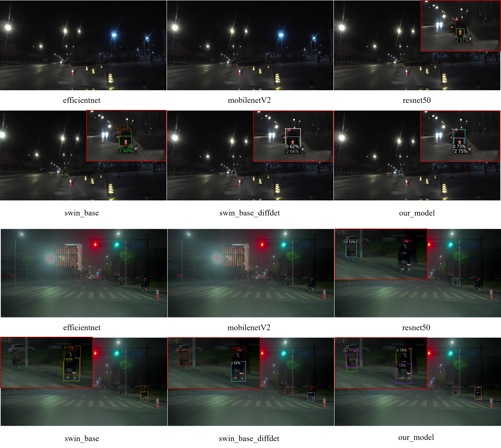

# TWDetector

TWDetector 是一个面向低照度交通场景的两轮车目标检测项目。模型以
DiffusionDet 的迭代框去噪为检测主线，结合 Swin-DyT 主干网络与 BiFPN
多尺度特征融合，重点改善夜间、弱光、噪声、模糊、遮挡及小目标条件下的
骑行者和两轮车检测效果。

项目检测三个类别：

- `rider`：骑行者
- `bike`：自行车
- `motor`：摩托车

## 主要结果

在 Data-TWC 验证集上的主要结果如下：

| Sampling steps | AP | AP50 | AP75 | APs | APm | APl |
| ---: | ---: | ---: | ---: | ---: | ---: | ---: |
| 16 | 25.540 | 55.104 | 20.015 | 11.231 | 28.992 | 41.859 |

采样步数消融结果：

| Sampling steps | AP | APs |
| ---: | ---: | ---: |
| 1 | 24.162 | 10.229 |
| 4 | 25.068 | 11.191 |
| 8 | 24.674 | 11.132 |
| 16 | 25.540 | 11.231 |

完整配置、日志、指标和 COCO 格式预测结果位于 `results/`。

## 项目结构

```text
TWDetector/
├── environment.yml
├── checkpoints/                    # 请在此处放置模型权重
├── results/
│   ├── main_result/                # 主实验结果
│   ├── sampling_steps/             # 采样步数消融
│   └── visualization/              # 检测与对比图
└── DiffusionDet/
    ├── train.py                     # 训练与评估入口
    ├── demo.py                      # 图片、视频和摄像头推理
    ├── configs/
    │   └── diffdet_demo_swinbase_DyT_bifpn.yaml
    ├── diffusiondet/                # 模型实现
    └── datasets/coco/               # COCO 格式数据集
```

## 环境要求

推荐使用 Linux 或 WSL2、NVIDIA GPU 和 Conda。项目环境的主要版本为：

- Python 3.8
- PyTorch 2.2.0
- torchvision 0.17.0
- CUDA 12.1
- Detectron2 0.6

创建环境：

```bash
conda env create -f environment.yml
conda activate env_yang
```

验证关键依赖：

```bash
python -c "import torch, detectron2, cv2; print(torch.__version__); print(torch.cuda.is_available())"
```

如果 Detectron2 未能随环境文件正确安装，可在其余依赖安装完成后尝试：

```bash
python -m pip install "git+https://github.com/facebookresearch/detectron2.git@v0.6"
```

`environment.yml` 来源于 Linux CUDA 环境，不建议直接在原生 Windows 环境中
创建；Windows 用户推荐使用 WSL2。

## 数据集

项目使用 COCO detection 格式，默认目录为
`DiffusionDet/datasets/coco/`：

```text
coco/
├── annotations/
│   ├── instances_train2017.json
│   ├── instances_val2017.json
│   └── instances_val2017_main.json
├── train2017/
├── val2017/
└── val2017_main/
```

| 划分 | 图片数 | 来源 | 用途 |
| --- | ---: | --- | --- |
| `train2017` | 6,394 | BDD100K | Data-TWC 训练集 |
| `val2017` | 343 | BDD100K | Data-TWC 主验证集 |
| `val2017_main` | 883 | CODA | Data-Lowlight 补充测试集 |

也可以通过环境变量指定其他 COCO 数据目录：

```bash
export TWDETECTOR_DATASET=/absolute/path/to/coco
```

默认验证划分是 `val2017`。切换到补充低照度测试集：

```bash
export TWDETECTOR_VAL_SPLIT=val2017_main
```

数据图片来源于
[BDD100K](https://bdd-data.berkeley.edu/download.html) 和
[CODA](https://coda-dataset.github.io/download.html)。使用或再发布数据时，
请遵守原始数据集的许可和引用要求。

## 模型权重

模型权重体积约 1.98 GB，未上传至本仓库。请将取得的权重保存为：

```text
checkpoints/twdetector_sample_step_16.pth
```

配置文件默认从该位置读取权重。从 `DiffusionDet` 目录运行命令时，对应路径为：

```text
../checkpoints/twdetector_sample_step_16.pth
```

如需使用其他权重，可通过命令行参数 `MODEL.WEIGHTS` 覆盖。

## 快速开始

以下命令均从 `DiffusionDet` 目录运行：

```bash
cd DiffusionDet
```

### 模型评估

```bash
python train.py \
  --num-gpus 1 \
  --eval-only \
  --config-file configs/diffdet_demo_swinbase_DyT_bifpn.yaml \
  MODEL.WEIGHTS ../checkpoints/twdetector_sample_step_16.pth \
  OUTPUT_DIR ./OUTPUT/evaluation
```

### 单张图片推理

```bash
mkdir -p output

python demo.py \
  --config-file configs/diffdet_demo_swinbase_DyT_bifpn.yaml \
  --input /absolute/path/to/image.jpg \
  --output ./output/image_result.jpg \
  --confidence-threshold 0.5 \
  --opts MODEL.WEIGHTS ../checkpoints/twdetector_sample_step_16.pth
```

### 批量图片推理

```bash
python demo.py \
  --config-file configs/diffdet_demo_swinbase_DyT_bifpn.yaml \
  --input "/absolute/path/to/images/*.jpg" \
  --output ./output \
  --confidence-threshold 0.5 \
  --opts MODEL.WEIGHTS ../checkpoints/twdetector_sample_step_16.pth
```

### 视频推理

```bash
python demo.py \
  --config-file configs/diffdet_demo_swinbase_DyT_bifpn.yaml \
  --video-input /absolute/path/to/input.mp4 \
  --output ./output/output.mp4 \
  --confidence-threshold 0.5 \
  --opts MODEL.WEIGHTS ../checkpoints/twdetector_sample_step_16.pth
```

## 训练

使用指定权重继续训练或微调：

```bash
python train.py \
  --num-gpus 1 \
  --config-file configs/diffdet_demo_swinbase_DyT_bifpn.yaml \
  MODEL.WEIGHTS ../checkpoints/twdetector_sample_step_16.pth
```

从随机初始化开始训练：

```bash
python train.py \
  --num-gpus 1 \
  --config-file configs/diffdet_demo_swinbase_DyT_bifpn.yaml \
  MODEL.WEIGHTS ""
```

Detectron2 支持在命令末尾用 `KEY VALUE` 临时覆盖配置，例如：

```bash
python train.py \
  --num-gpus 1 \
  --config-file configs/diffdet_demo_swinbase_DyT_bifpn.yaml \
  SOLVER.IMS_PER_BATCH 2 \
  SOLVER.MAX_ITER 20000 \
  OUTPUT_DIR ./OUTPUT/my_experiment \
  MODEL.WEIGHTS ../checkpoints/twdetector_sample_step_16.pth
```

训练输出默认写入 `DiffusionDet/OUTPUT/`，该目录及生成的 checkpoint 已被
`.gitignore` 排除。

## 调整采样步数

默认扩散采样步数为 16。快速评估 1 步推理：

```bash
python train.py \
  --num-gpus 1 \
  --eval-only \
  --config-file configs/diffdet_demo_swinbase_DyT_bifpn.yaml \
  MODEL.WEIGHTS ../checkpoints/twdetector_sample_step_16.pth \
  MODEL.DiffusionDet.SAMPLE_STEP 1 \
  OUTPUT_DIR ./OUTPUT/sample_step_1
```

常用取值包括 `1`、`4`、`8` 和 `16`。比较不同采样步数时，除
`SAMPLE_STEP` 与输出目录外，应保持权重、数据和其他参数一致。

## 可视化示例

综合模型对比：



TWDetector 检测结果：


## 许可证

代码许可信息见 [LICENSE](LICENSE)。数据集、第三方代码和预训练模型仍受其
各自许可证与使用条款约束。
